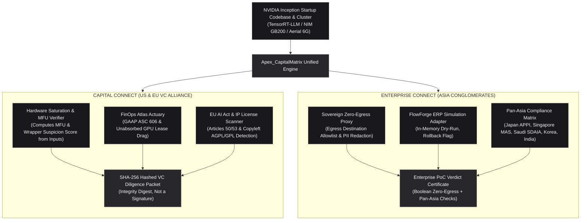

# Apex_CapitalMatrix (`apex-capitalmatrix`)

**Sovereign NVIDIA VC Alliance Diligence & Enterprise Connect Air-Gapped PoC Operating System**

[](LICENSE)
[](https://python.org)
[](https://www.nvidia.com/en-us/startups/)
[-green.svg)](#)
[](tests/)

---

## Executive Summary

For the 18,000+ AI startups in the **NVIDIA Inception Program**, commercial scaling across the US, Europe, and Asia is halted by two structural barriers:

1. **Capital Connect (US & EU VC Alliance)**: Top venture capital firms (a16z, Sequoia, NVentures, Index, Balderton, EQT) reject over 90% of applicants due to the **"API Wrapper Suspicion"**, unverified Model FLOPs Utilization (MFU), undisclosed multi-year unabsorbed GPU lease liabilities (e.g. 1,024 contracted H100s), and missing **EU AI Act** compliance records.
2. **Enterprise Connect (Asia-Pacific & GCC)**: Major conglomerates (NTT, SoftBank, Singtel, Keppel, Aramco, Reliance, Samsung) operate under strict sovereign data mandates (Japan APPI/METI, Singapore MAS TRM, Saudi SDAIA, Korea PIPA, India DPDP). Startups face a **9 to 14 month PoC freeze** because enterprises refuse multi-tenant cloud API egress and fear destructive agent tool mutations in production ERP databases.

**Apex_CapitalMatrix** (`apex-capitalmatrix`) resolves this dual dilemma by delivering a sovereign, zero-dependency, pure Python standard library runtime that:
* Generates a tamper-evident (SHA-256 hashed) **"NVIDIA Capital Connect Diligence Packet"** reporting computed Model FLOPs Utilization (MFU), Token-per-Dollar throughput, GAAP ASC 606 reconciled revenue, and EU AI Act compliance. The SHA-256 digest is an integrity hash, not a cryptographic signature (no signing key or verification step exists).
* Provides an in-process **Zero-Egress Sovereign Air-Gap Proxy** model with in-memory synthetic ERP dry-run simulation; its approval outcome is a boolean-derived `GREENLIGHT_48H` verdict flag, not a measured approval timeline.

---

## Archify System Architecture



---

## Core Capabilities

### 1. Hardware Saturation & Model FLOPs Utilization (MFU)
* Evaluates peak dense FP8 Tensor Core throughput across **NVIDIA GB200 NVL72**, **H100 SXM5**, **H200**, **L40S**, and **A100**.
* Compares achieved forward-pass FLOPs ($\text{FLOPs} = 2 \cdot P \cdot T_{\text{sec}}$) against cluster capacity to calculate true MFU percentage.
* Evaluates KV-cache hit rates and latency jitter to formally calculate a **Wrapper Suspicion Score** ($0.0$ to $1.0$).

### 2. FinOps Atlas Actuary
* Re-implements a local ASC 606-style reconciliation (reported ARR minus identified misclassified services); the name **`project-atlas-due-diligence`** is referenced only in docstrings and no code is imported from it.
* Computes cash drag from unabsorbed GPU cluster lease commitments (e.g., 128 contracted nodes with sub-50% utilization); the name **`tech-balance-sheet`** is referenced only in docstrings and no code is imported from it.
* Calculates EBITDA valuation haircuts and structures Reps & Warranties indemnity escrow holdbacks.

### 3. EU AI Act & IP License Scanner
* Audits compliance against **EU AI Act Articles 50 and 53** (transparency/synthetic watermarking and training-summary disclosures); Article 52 is not implemented.
* Regex-matches a caller-supplied dependency list for viral copyleft license strings (`AGPL-3.0`, `GPL-2.0`, `SSPL`) that would compromise commercial IP ownership. It does not parse a codebase AST.

### 4. Sovereign Air-Gap Zero-Egress Proxy
* Provides an in-process proxy that flags a payload whose destination string is not on a hardcoded sovereign allowlist and regex-redacts PII/credentials (credit cards, email addresses, JWT/bearer tokens, cloud API keys, private-key headers). It does not intercept OS-level sockets and does not redact passwords.
* Includes a self-contained `FlowForgeSimulationReplayAdapter` that returns an in-memory dry-run record with `rollback_guaranteed=True`; it does not contact SAP S/4HANA, Salesforce CRM, or Oracle ERP. Integration with **`flowforge`** ([`enterprise-ai-integration-platform`](https://github.com/AAH20/enterprise-ai-integration-platform)) is roadmap.

### 5. Pan-Asia Regulatory Compliance Matrix
* Built-in jurisdictional scoring for the 5 dominant Asian regulatory frameworks:
  1. **Japan**: APPI & METI AI Governance Guidelines
  2. **Singapore**: MAS TRM Guidelines & IMDA Model AI Governance Framework (FEAT)
  3. **Saudi Arabia / GCC**: SDAIA NDMO & UAE Federal Data Protection Law
  4. **South Korea**: Personal Information Protection Act (PIPA)
  5. **India**: Digital Personal Data Protection (DPDP) Act 2023

---

## Installation

### Option 1: Install via Wheel
```bash
pip install apex-capitalmatrix
```

### Option 2: Zero-Install Standard Library Execution
```bash
git clone https://github.com/AAH20/apex-capitalmatrix.git
cd apex-capitalmatrix
python3 -m apex_capitalmatrix.cli --help
```

---

## Command-Line Interface (CLI)

```bash
# 1. Run a local synthetic MFU benchmark (CPU loop; no GPU is exercised)
capitalmatrix benchmark --arch GB200_NVL72 --iterations 10

# 2. Run complete Capital Connect VC due diligence audit
capitalmatrix audit-vc --startup "Apex Growth Systems LLC" --arr 25000000 --ebitda 6000000

# 3. Verify Asian Enterprise Connect air-gap PoC and synthetic ERP simulation
capitalmatrix poc-verify --startup "Apex Growth Systems LLC" --client "Singtel Enterprise Asia"

# 4. View local GPU FinOps spend telemetry (in-process log, no cluster connection)
capitalmatrix finops

# 5. Output executive markdown diligence memo
capitalmatrix report
```

---

## Programmatic Python API

```python
from apex_capitalmatrix.orchestrator import ApexCapitalMatrixOrchestrator
from apex_capitalmatrix.core.primitives import GpuArchitecture, TargetRegion

# Initialize orchestrator with $10.00 evaluation budget
orchestrator = ApexCapitalMatrixOrchestrator(default_budget_usd=10.00)

# Run Capital Connect VC Due Diligence (US & EU VC Alliance)
packet = orchestrator.run_capital_connect_diligence(
    startup_name="Apex Growth Systems LLC",
    target_region=TargetRegion.US_CAPITAL_CONNECT,
    gpu_arch=GpuArchitecture.H100_SXM5,
    reported_arr_usd=25_000_000.0,
    reported_ebitda_usd=6_500_000.0,
)

print(f"VC Readiness Score: {packet.vc_readiness_score} / 100.0")
print(f"Achieved MFU      : {packet.mfu_metrics.mfu_percentage}%")
print(f"ActionLedger SHA  : {packet.action_ledger_sha256}")

# Run Asian Enterprise Connect Air-Gapped PoC Verification
cert = orchestrator.run_enterprise_connect_poc(
    startup_name="Apex Growth Systems LLC",
    enterprise_client="Singtel Enterprise Asia",
)

print(f"Approval Verdict  : {cert.approval_verdict.value}")
print(f"Zero-Egress State : {'VERIFIED' if cert.airgap_status.zero_egress_verified else 'FAILED'}")
print(f"Pan-Asia Matrix   : {'5/5 PASSED' if cert.pan_asia_compliance.all_passed else 'CONDITIONAL'}")
```

---

## Ecosystem Synergies

`Apex_CapitalMatrix` ships local, in-memory adapter stubs named after the **`AAH20`** institutional portfolio. None of them make network calls or import those projects — the integrations below are roadmap:

* **[`enterprise-ai-production-control-plane`](https://github.com/AAH20/enterprise-ai-production-control-plane)** (`aicontrol`): Local `ControlPlaneFinOpsAdapter` that logs caller-supplied GPU allocations and sums spend; no cluster connection or inference routing.
* **[`enterprise-ai-integration-platform`](https://github.com/AAH20/enterprise-ai-integration-platform)** (`flowforge`): Local `FlowForgeSimulationReplayAdapter` returning an in-memory dry-run record; does not contact SAP/Oracle/Salesforce.
* **[`apex-treecompute`](https://github.com/AAH20/apex-treecompute)**: Not integrated — reference only.
* **`project-atlas-due-diligence` & `tech-balance-sheet`**: Reference only — the ASC 606 and lease-liability formulas are re-implemented locally; no code is imported.
* **Cloudflare Clef**: Local `ClefEdgeReplicator` storing packets in a Python dict and returning a hardcoded `COMMITTED_SUB_100US` status label; no edge network or consensus.
* **Hermes Paperclip**: Self-contained `PaperclipBudgetGovernor` micro-USD budget governance with SHA-256 `ActionLedger` receipts; no `@paperclipai/hermes-paperclip-adapter` dependency.
* **NVIDIA Aerial 6G**: Local `Aerial6GConnector` that checks a caller-supplied latency against a 5ms SLA threshold; does not connect to the Aerial 6G SDK, TensorRT-LLM, or NIM.

---

## Test Suite Execution

All 19 unit and integration tests pass with zero external dependencies (the runtime varies by machine — no fixed timing is guaranteed):

```bash
python3 -m unittest discover -s tests -v
```

```
test_aerial_6g_urllc_decision_sla ... ok
test_airgap_proxy_pii_redaction ... ok
test_airgap_proxy_unauthorized_egress_block ... ok
test_alibaba_code_review_adapter ... ok
test_clef_edge_consensus_replication ... ok
test_cli_subcommands ... ok
test_control_plane_finops_accounting ... ok
test_eu_ai_act_clean_project ... ok
test_eu_ai_act_copyleft_and_prohibited_detection ... ok
test_finops_atlas_actuary_revenue_reconciliation ... ok
test_finops_unabsorbed_gpu_lease_drag ... ok
test_flowforge_simulation_replay_safety ... ok
test_hardware_saturation_verifier ... ok
test_orchestrator_capital_connect_diligence ... ok
test_orchestrator_enterprise_connect_poc ... ok
test_orchestrator_markdown_report_generation ... ok
test_pan_asia_compliance_full_pass ... ok
test_paperclip_budget_governor_deductions_and_exhaustion ... ok
test_synthetic_benchmark_execution ... ok

Ran 19 tests (OK)
```

---

## License

Apex_CapitalMatrix is licensed under the [Apache 2.0 License](LICENSE).  
Copyright © 2026 Ahmed Hassan / Apex Growth Systems LLC.
