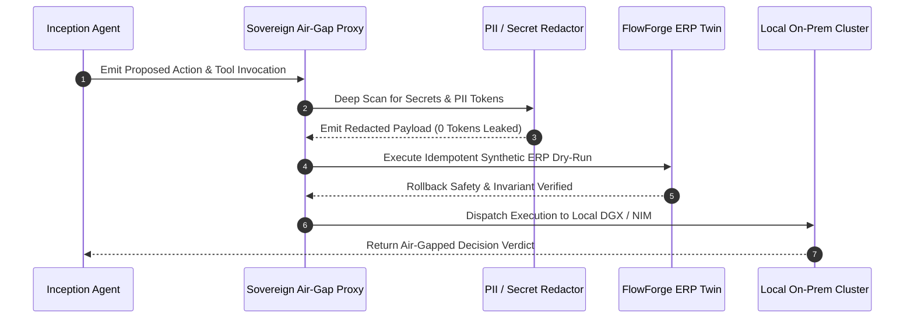

# Mathematical & Algorithmic Specification: Apex_CapitalMatrix

## Sovereign NVIDIA VC Alliance Diligence & Enterprise Connect Air-Gapped PoC Engine

```
Classification:   Tier-1 Autonomous Due Diligence & Air-Gapped PoC Operating System
Target Standards: NVIDIA Inception Capital Connect (US/EU) & Enterprise Connect (Asia)
Runtime:          Python 3.9+ (Zero External Dependencies, Pure Standard Library)
```

---

## 1. Hardware Saturation & Model FLOPs Utilization (MFU)

To formally audit whether an Inception startup possesses proprietary accelerated computing IP or operates a third-party API wrapper, `HardwareSaturationVerifier` calculates the realized Model FLOPs Utilization (MFU):

### 1.1 Forward Pass Compute Formulation

For a transformer-based decoder model with parameter count $P$, generating a single token requires approximately $2P$ floating-point operations (FLOPs) during the forward pass:

$$\text{FLOPs}_{\text{token}} = 2 \cdot P$$

Given an empirical inference throughput $T_{\text{sec}}$ (tokens per second), the realized compute generation is:

$$\text{FLOPs}_{\text{achieved}} = 2 \cdot P \cdot T_{\text{sec}}$$

$$\text{TFLOPS}_{\text{achieved}} = \frac{\text{FLOPs}_{\text{achieved}}}{10^{12}}$$

### 1.2 Model FLOPs Utilization (MFU) Percentage

Given a hardware cluster with $N_{\text{chips}}$ GPUs, where each chip delivers a peak theoretical FP8 Tensor Core throughput of $\Phi_{\text{theoretical}}$ (TFLOPS), the total cluster compute capacity is:

$$\Phi_{\text{cluster}} = N_{\text{chips}} \cdot \Phi_{\text{theoretical}}$$

$$\text{MFU} = \min\left(100.0, \frac{\text{TFLOPS}_{\text{achieved}}}{\Phi_{\text{cluster}}} \times 100\right)$$

### 1.3 Token-per-Dollar (TPD) Unit Economics

With a cumulative hourly GPU cluster lease cost $C_{\text{hourly}}$:

$$\text{TPD} = \frac{T_{\text{sec}} \cdot 3600}{C_{\text{hourly}}}$$

### 1.4 Wrapper Suspicion Index $\mathcal{S}_{\text{wrapper}}$

$$\mathcal{S}_{\text{wrapper}} = w_{\text{mfu}} \cdot \mathbb{I}(\text{MFU} < 20\%) + w_{\text{jitter}} \cdot \mathbb{I}(\sigma_{\text{http}} > 35\,\text{ms}) + w_{\text{kv}} \cdot \mathbb{I}(\kappa_{\text{hit}} < 0.30)$$

* Startups exhibiting $\mathcal{S}_{\text{wrapper}} \le 0.35$ and $\kappa_{\text{hit}} \ge 0.80$ receive the verified **NVIDIA Deep Tech Attestation**.

---

## 2. Atlas FinOps & GAAP ASC 606 Revenue Audit

Re-implements locally (no imports) ASC 606-style revenue accounting and compute lease-liability formulas; the names `project-atlas-due-diligence`, `tech-balance-sheet`, and `ma_vdr_diligence_os` are referenced only in docstrings.

### 2.1 GAAP ASC 606 Revenue Reconciliation

$$\text{ARR}_{\text{reconciled}} = \text{ARR}_{\text{reported}} - \Delta_{\text{services}}$$

where $\Delta_{\text{services}}$ represents identified non-recurring professional services or POC fees erroneously classified as recurring SaaS revenue.

### 2.2 Unabsorbed GPU Cluster Lease Drag

Given a committed multi-year cluster reservation of $N_{\text{chips}}$ at an hourly rate $R_{\text{hourly}}$ with tenant workload absorption rate $\alpha_{\text{absorption}}$:

$$\text{Cost}_{\text{annual}} = N_{\text{chips}} \cdot R_{\text{hourly}} \cdot 8760$$

$$\text{Drag}_{\text{unabsorbed}} = \text{Cost}_{\text{annual}} \cdot (1 - \alpha_{\text{absorption}})$$

### 2.3 EBITDA Haircut & Valuation Adjustment

$$\text{EBITDA}_{\text{adjusted}} = \text{EBITDA}_{\text{reported}} - 0.40 \cdot \Delta_{\text{services}} - \text{Drag}_{\text{unabsorbed}}$$

$$\text{Haircut}_{\%} = \frac{\text{EBITDA}_{\text{reported}} - \text{EBITDA}_{\text{adjusted}}}{\text{EBITDA}_{\text{reported}}} \times 100$$

### 2.4 Compute Return on Invested Capital (Compute ROIC)

$$\text{Compute ROIC} = \frac{\text{ARR}_{\text{reconciled}}}{\text{Cost}_{\text{annual}}}$$

---

## 3. Sovereign Air-Gap Zero-Egress Formal Verification

For Asian Enterprise Connect deployments (Japan, Singapore, GCC, South Korea, India), the proxy models a zero-egress boundary (a destination-allowlist string check plus PII redaction; it does not intercept OS-level network traffic):



### 3.1 PII & Secret Redaction Engine

Scans and masks credentials with $O(N)$ regex passes:
* Credit Cards (16-digit patterns; no Luhn validation)
* Email addresses
* JWT / Bearer tokens (`eyJ...`)
* Cloud API Keys (`AKIA...`, `ABIA...`, `ACCA...`, `ASIA...`)
* Private cryptographic keys (`-----BEGIN ... KEY-----`)

### 3.2 Egress Destination Gating

Compares a caller-supplied destination string against a hardcoded sovereign allowlist (`127.0.0.1`, `localhost`, `::1`, `sovereign.local`, `*.internal`). A non-allowlisted destination is flagged and the attempt is appended to the audit log. This is a string comparison only — no OS-level DNS or TCP socket is intercepted.

---

## 4. Pan-Asia Jurisdictional Compliance Scoring

$$\mathcal{C}_{\text{Asia}} = \frac{1}{5} \sum_{j \in \{\text{JP}, \text{SG}, \text{SA}, \text{KR}, \text{IN}\}} \mathcal{S}_j$$

* **Japan (APPI & METI)**: Weights cross-border transfer prevention (0.35), explainability (0.35), and consent management (0.30).
* **Singapore (MAS TRM & IMDA FEAT)**: Weights air-gapped encryption (0.30), SHA-256 audit logs (0.35), and explainability (0.35).
* **Saudi Arabia / GCC (SDAIA NDMO)**: Weights sovereign data residency (0.45), zero cross-border egress (0.35), and encryption (0.20).
* **South Korea (PIPA)**: Weights consent tracking (0.35), air-gapped encryption (0.35), and zero egress (0.30).
* **India (DPDP Act 2023)**: Weights consent management (0.40), SHA-256 audit trail (0.35), and local data residency (0.25).
