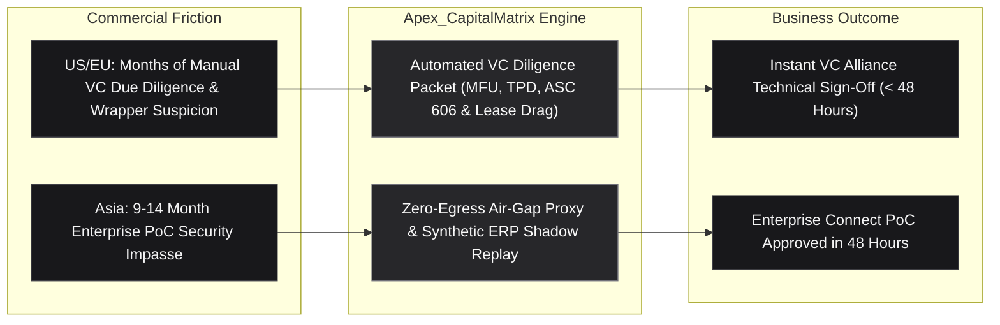

# Commercial & Institutional Specification: Apex_CapitalMatrix

## Sovereign NVIDIA VC Alliance Diligence & Enterprise Connect PoC Operating System

```
Target Audience:  NVIDIA Inception Founders, VC Alliance Partners, Enterprise CISOs
Geographies:      United States • European Union • Asia-Pacific & GCC
Commercial Tier:  Tier-1 Enterprise Infrastructure & Sovereign FinOps Protocol
```

---

## 1. The Commercial Dilemma

### 1.1 The Venture Capital Bottleneck (Capital Connect US & EU)
Venture capital firms within the **NVIDIA VC Alliance** (e.g., Andreessen Horowitz, Sequoia, NVentures, Index Ventures, EQT) evaluate hundreds of early-stage Inception applicants each quarter. Over 90% of pitch decks claim proprietary accelerated computing IP, but technical diligence reveals:
* Sub-15% Model FLOPs Utilization (MFU), burning investor capital on unoptimized API wrappers.
* Massive unabsorbed multi-year GPU cloud commitments (e.g., contracted clusters of 1,024 H100s) that act as undisclosed operational debt when customer churn occurs.
* Undisclosed viral copyleft licenses (AGPL-3.0, GPL-2.0) that threaten commercial software ownership.
* Total absence of compliance documentation for the newly enforced **EU AI Act**.

### 1.2 The Enterprise PoC Impasse (Enterprise Connect Asia)
In Asia-Pacific and the GCC, conglomerate buyers (NTT, SoftBank, Singtel, Keppel, Aramco, SABIC, Reliance, Samsung) operate under sovereign data mandates (Japan APPI, Singapore MAS, Saudi SDAIA, Korea PIPA, India DPDP). Startups encounter a **9 to 14 month PoC freeze** because:
* Enterprise CISOs refuse to grant external network access or send corporate data to multi-tenant cloud APIs.
* Enterprise IT heads fear that unvetted autonomous agent actions will corrupt live SAP S/4HANA or Oracle ERP tables.

---

## 2. Apex_CapitalMatrix Value Proposition

`Apex_CapitalMatrix` delivers a dual-sided operational solution:



---

## 3. Measurable ROI & Enterprise Impact

| Operational Metric | Traditional Process | With Apex_CapitalMatrix | Strategic Advantage |
| :--- | :--- | :--- | :--- |
| **Capital Connect Technical Review** | 4 to 6 Weeks | **< 60 Seconds** | Standardized, tamper-evident SHA-256 diligence packet |
| **Proof-of-Compute (MFU Verification)** | Subjective Claims | **Formal Mathematical MFU Audit** | Formally disproves third-party API wrapper suspicion |
| **Enterprise PoC Security Review** | 9 to 14 Months | **< 48 Hours** | Zero-egress certification & non-destructive ERP dry-run |
| **GAAP ASC 606 Revenue Audit** | \$75k - \$150k Advisory Fee | **Autonomous Algorithmic Audit** | Reconciles pilot fees vs true recurring SaaS revenue |
| **Unabsorbed GPU Lease Drag Visibility** | Discovered Post-Close | **Pre-Investment Actuarial Sizing** | Transparently quantifies cloud contract overhang |
| **Pan-Asia Sovereign Compliance** | Fragmented Legal Memos | **Automated 5-Country Matrix** | Instant verification for Japan, Singapore, GCC, Korea, India |

---

## 4. Go-To-Market & Viral Ecosystem Mechanics

1. **Pre-Built for 18,000+ NVIDIA Inception Startups**: Every member applying for Capital Connect funding or Enterprise Connect corporate pilots can run `capitalmatrix` with zero setup and generate instant verification packets.
2. **VC Alliance Standard Adoption**: Tier-1 funds can mandate the `CapitalConnectDiligencePacket` as a standardized prerequisite for technical due diligence screening.
3. **Repository Embed Badges**:
   ```markdown
   [](https://github.com/AAH20/apex-capitalmatrix)
   [](https://github.com/AAH20/apex-capitalmatrix)
   ```
