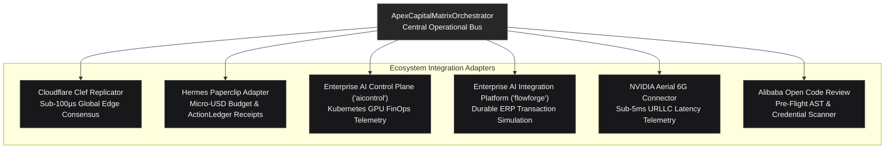

# Enterprise Integration Guide: Apex_CapitalMatrix

## Integrating Cloudflare Clef, Hermes Paperclip, Control Plane & FlowForge

```
Classification:   Production Enterprise Integration Specification
Frameworks:       Clef • Paperclip Company OS • aicontrol • flowforge • Aerial 6G
Runtime:          Pure Python Standard Library (Zero External Dependencies)
```

---

## 1. Architectural Overview



---

## 2. Programmatic Python API Quickstart

```python
from apex_capitalmatrix.orchestrator import ApexCapitalMatrixOrchestrator
from apex_capitalmatrix.core.primitives import GpuArchitecture, TargetRegion

# 1. Initialize orchestrator with $10.00 evaluation budget
orchestrator = ApexCapitalMatrixOrchestrator(
    default_budget_usd=10.00,
    cluster_name="k8s-dgx-superpod-us-east-1",
)

# 2. Run Capital Connect VC Due Diligence (US & EU VC Alliance)
diligence_packet = orchestrator.run_capital_connect_diligence(
    startup_name="Apex Growth Systems LLC",
    target_region=TargetRegion.US_CAPITAL_CONNECT,
    gpu_arch=GpuArchitecture.H100_SXM5,
    reported_arr_usd=25_000_000.0,
    reported_ebitda_usd=6_500_000.0,
)

print("VC Readiness Score:", diligence_packet.vc_readiness_score, "/ 100.0")
print("Achieved MFU      :", diligence_packet.mfu_metrics.mfu_percentage, "%")
print("Reconciled ARR    :", f"${diligence_packet.atlas_finops.gaap_asc_606_reconciled_arr_usd:,.2f}")
print("ActionLedger SHA  :", diligence_packet.action_ledger_sha256)

# 3. Run Asian Enterprise Connect Air-Gapped PoC Verification
poc_cert = orchestrator.run_enterprise_connect_poc(
    startup_name="Apex Growth Systems LLC",
    enterprise_client="Singtel Enterprise Asia",
    sample_erp_action="CREATE_PURCHASE_ORDER",
    sample_payload={"vendor_id": "VEND-102", "amount_sgd": 85000.0},
)

print("PoC Approval Verdict:", poc_cert.approval_verdict.value)
print("Zero-Egress Verified :", poc_cert.airgap_status.zero_egress_verified)
print("Pan-Asia Compliance  :", "5/5 PASSED" if poc_cert.pan_asia_compliance.all_passed else "CONDITIONAL")

# 4. Generate C-Suite Executive Memo
memo_markdown = orchestrator.generate_executive_markdown_report(diligence_packet, poc_cert)
print(memo_markdown)
```

---

## 3. Integration Specifications

### 3.1 Cloudflare Clef Edge Consensus (`ClefEdgeReplicator`)
- **Purpose**: Synchronizes verified diligence packets and PoC certificates across 330+ Cloudflare edge nodes with monotonic sequence numbers and deterministic SHA-256 digests.
- **Fail-Safe**: In-memory ring buffer with monotonic sequence numbers and zero network latency overhead.

### 3.2 Hermes Paperclip Budget Governor (`PaperclipBudgetGovernor`)
- **Purpose**: Enforces micro-USD budget ceilings (e.g., \$0.125 per diligence run, \$0.085 per PoC verification).
- **Audit Trail**: Generates tamper-evident `ActionLedger` receipts containing cumulative spend, remaining balance, and cryptographic digests.

### 3.3 Enterprise AI Production Control Plane (`ControlPlaneFinOpsAdapter`)
- **Repository**: [`https://github.com/AAH20/enterprise-ai-production-control-plane`](https://github.com/AAH20/enterprise-ai-production-control-plane) (`aicontrol`).
- **Telemetry**: Logs GPU count, node pool, allocation hours, and dollar expenditure for Kubernetes-based DGX SuperPOD environments.

### 3.4 Enterprise AI Integration Platform (`FlowForgeSimulationReplayAdapter`)
- **Repository**: [`https://github.com/AAH20/enterprise-ai-integration-platform`](https://github.com/AAH20/enterprise-ai-integration-platform) (`flowforge`).
- **Safety**: Dry-runs ERP actions against a synthetic shadow twin, verifying idempotency and guaranteed rollback before live production mutations.

### 3.5 NVIDIA Aerial 6G Connector (`Aerial6GConnector`)
- **Purpose**: Monitors sub-5ms Ultra-Reliable Low-Latency Communication (URLLC) decision SLAs for edge telecommunications and autonomous robotics deployments.

### 3.6 Alibaba Open Code Review Adapter (`AlibabaCodeReviewAdapter`)
- **Purpose**: Pre-flight AST static analysis inspecting for dynamic execution risks (`eval`, `exec`), unsafe deserialization, and hardcoded credential patterns.
