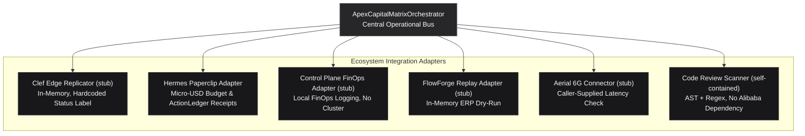

# Enterprise Integration Guide: Apex_CapitalMatrix

## Adapter Stubs: Cloudflare Clef, Hermes Paperclip, Control Plane & FlowForge

```
Classification:   Production Enterprise Integration Specification
Adapter Names:    Clef • Paperclip Company OS • aicontrol • flowforge • Aerial 6G (local stubs)
Runtime:          Pure Python Standard Library (Zero External Dependencies)
```

---

## 1. Architectural Overview



---

## 2. Programmatic Python API Quickstart

```python
from apex_capitalmatrix.orchestrator import ApexCapitalMatrixOrchestrator
from apex_capitalmatrix.core.primitives import GpuArchitecture, TargetRegion

# 1. Initialize orchestrator with $10.00 evaluation budget
orchestrator = ApexCapitalMatrixOrchestrator(
    default_budget_usd=10.00,
    cluster_name="k8s-dgx-superpod-us-east-1",
)

# 2. Run Capital Connect VC Due Diligence (US & EU VC Alliance)
diligence_packet = orchestrator.run_capital_connect_diligence(
    startup_name="Apex Growth Systems LLC",
    target_region=TargetRegion.US_CAPITAL_CONNECT,
    gpu_arch=GpuArchitecture.H100_SXM5,
    reported_arr_usd=25_000_000.0,
    reported_ebitda_usd=6_500_000.0,
)

print("VC Readiness Score:", diligence_packet.vc_readiness_score, "/ 100.0")
print("Achieved MFU      :", diligence_packet.mfu_metrics.mfu_percentage, "%")
print("Reconciled ARR    :", f"${diligence_packet.atlas_finops.gaap_asc_606_reconciled_arr_usd:,.2f}")
print("ActionLedger SHA  :", diligence_packet.action_ledger_sha256)

# 3. Run Asian Enterprise Connect Air-Gapped PoC Verification
poc_cert = orchestrator.run_enterprise_connect_poc(
    startup_name="Apex Growth Systems LLC",
    enterprise_client="Singtel Enterprise Asia",
    sample_erp_action="CREATE_PURCHASE_ORDER",
    sample_payload={"vendor_id": "VEND-102", "amount_sgd": 85000.0},
)

print("PoC Approval Verdict:", poc_cert.approval_verdict.value)
print("Zero-Egress Verified :", poc_cert.airgap_status.zero_egress_verified)
print("Pan-Asia Compliance  :", "5/5 PASSED" if poc_cert.pan_asia_compliance.all_passed else "CONDITIONAL")

# 4. Generate C-Suite Executive Memo
memo_markdown = orchestrator.generate_executive_markdown_report(diligence_packet, poc_cert)
print(memo_markdown)
```

---

## 3. Integration Specifications

### 3.1 Clef Edge Replicator (`ClefEdgeReplicator`) — local stub
- **Purpose**: Stores verified diligence packets and PoC certificates in an in-process Python dict with monotonic sequence numbers and deterministic SHA-256 digests. No Cloudflare edge nodes are contacted; the `COMMITTED_SUB_100US` status is a hardcoded string.
- **Fail-Safe**: In-memory dict with monotonic sequence numbers; no network layer exists. Real Cloudflare Clef edge consensus is roadmap.

### 3.2 Paperclip Budget Governor (`PaperclipBudgetGovernor`) — self-contained
- **Purpose**: Enforces micro-USD budget ceilings (e.g., \$0.125 per diligence run, \$0.085 per PoC verification). No `@paperclipai/hermes-paperclip-adapter` package exists or is used.
- **Audit Trail**: Generates SHA-256 `ActionLedger` receipts containing cumulative spend, remaining balance, and digests (integrity hashes, not signatures).

### 3.3 Control Plane FinOps Adapter (`ControlPlaneFinOpsAdapter`) — local stub
- **Repository**: Names [`https://github.com/AAH20/enterprise-ai-production-control-plane`](https://github.com/AAH20/enterprise-ai-production-control-plane) (`aicontrol`), but no code from it is imported and no network calls are made.
- **Telemetry**: Logs caller-supplied GPU count, node pool, allocation hours, and dollar expenditure to an in-memory list; it does not connect to a Kubernetes cluster.

### 3.4 FlowForge Simulation Replay Adapter (`FlowForgeSimulationReplayAdapter`) — local stub
- **Repository**: Names [`https://github.com/AAH20/enterprise-ai-integration-platform`](https://github.com/AAH20/enterprise-ai-integration-platform) (`flowforge`), but no code from it is imported and no network calls are made.
- **Safety**: Returns an in-memory dry-run record with `rollback_guaranteed=True` and `production_impact="ZERO_MUTATION_DRY_RUN_ISOLATED"`; it does not contact SAP S/4HANA, Salesforce CRM, or Oracle ERP.

### 3.5 Aerial 6G Connector (`Aerial6GConnector`) — local stub
- **Purpose**: Records a caller-supplied latency value and checks it against a 5ms SLA threshold. It does not connect to the NVIDIA Aerial 6G SDK, TensorRT-LLM, or NIM.

### 3.6 Code Review Adapter (`AlibabaCodeReviewAdapter`) — self-contained
- **Purpose**: Pre-flight Python AST + regex static analysis inspecting for dynamic execution risks (`eval`, `exec`, `pickle.loads`, `os.system`, `subprocess.Popen`) and hardcoded credential patterns. No Alibaba/AnyAgent dependency exists.
